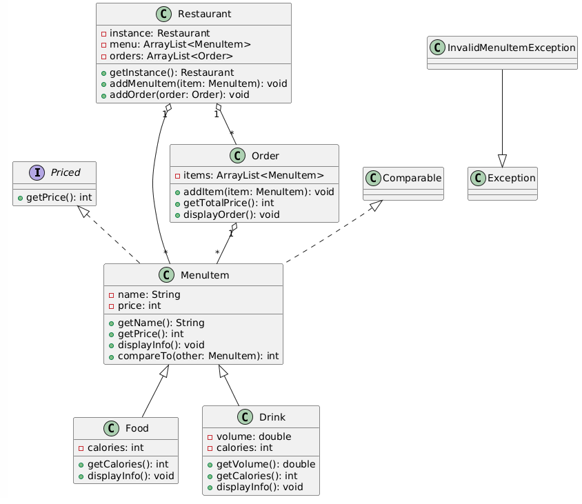

# RestaurantManagement

## A projekt bemutatása

A RestaurantManagement egy Java nyelven készült, konzolos étteremkezelő alkalmazás, amely lehetővé teszi az étlap és a rendelések kezelését.

## Funkciók

- Ételek és italok hozzáadása az étlaphoz
- Az étlap megjelenítése
- Menüelemek keresése név alapján
- Menüelemek rendezése ár szerint
- Új rendelések létrehozása
- Rendelések és végösszegek megjelenítése
- Adatok mentése és betöltése szöveges fájlokból

## Tesztelés

A projekt JUnit teszteket tartalmaz, amelyek ellenőrzik a rendelés végösszegének kiszámítását és a negatív árak kezelését.

## Futtatás

1. A projekt megnyitása IntelliJ IDEA-ban.
2. A Maven-függőségek betöltése.
3. A Main.java osztály futtatása.
4. A konzolos menü használata.

## UML-osztálydiagram

